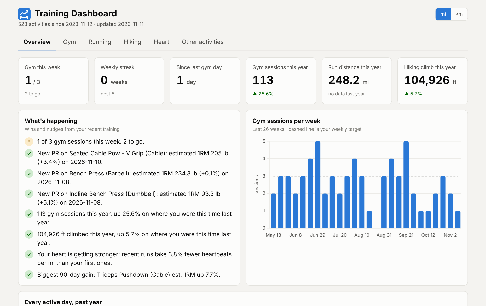
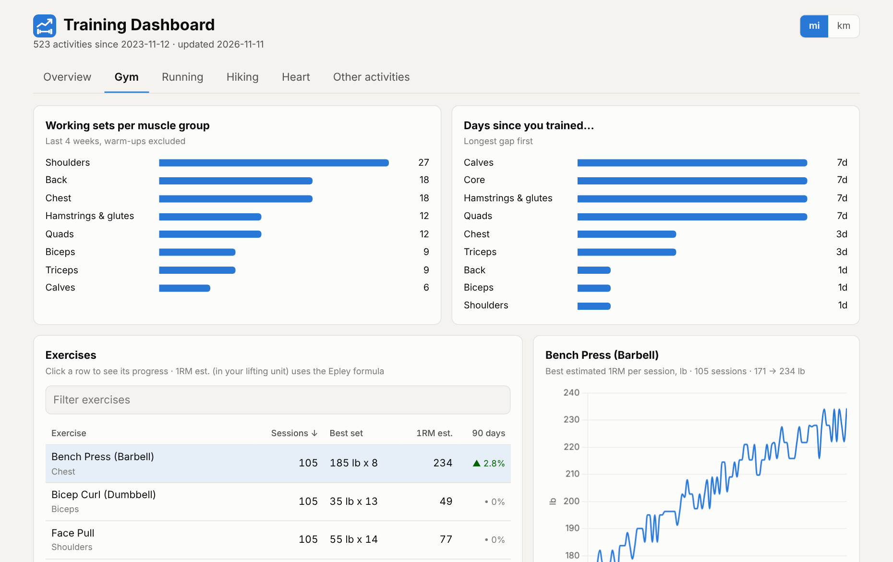
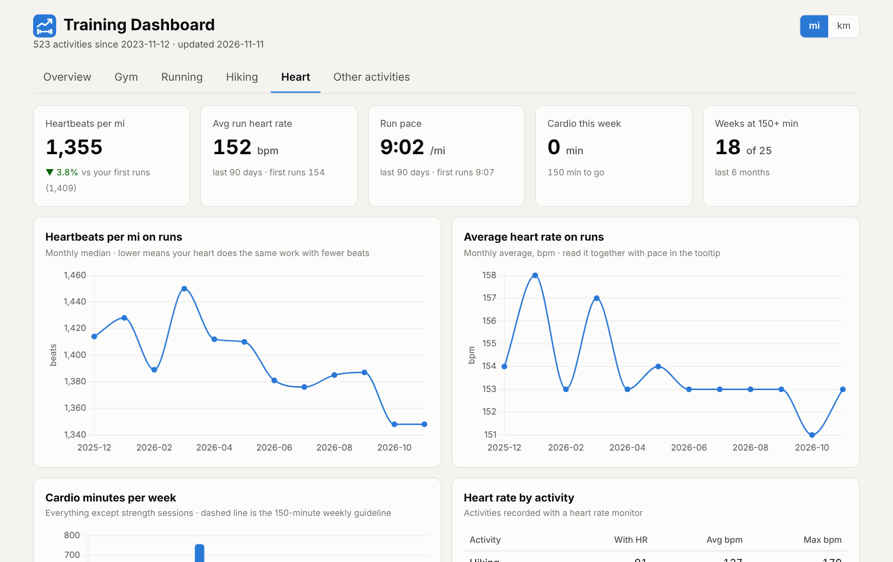

# Strava Training Dashboard

A dashboard for everything you log on Strava: gym workouts, runs, hikes and
every other sport. It shows what you've improved, your streaks and personal
records, and what to train next.

If you log your lifting in [Hevy](https://www.hevyapp.com/) and let it post
workouts to Strava, every set (exercise, weight, reps) is read from the
workout description. No Hevy Pro subscription is needed.



## What you get

- **Overview:** weekly gym goal and streak, wins and nudges ("New PR on Squat",
  "9 days since you trained legs"), a year of active days, and this year vs
  last year.
- **Gym:** estimated one-rep max over time for every exercise, recent PRs,
  working sets per muscle group, and days since each muscle group was trained.
- **Running:** monthly distance, pace on every run, fastest 5k+ and longest run.
- **Hiking:** elevation and distance per year, biggest climbs.
- **Heart:** heartbeats per mile on runs (fewer beats for the same distance
  means a fitter heart), heart rate trends, and weekly cardio minutes against
  the 150-minute guideline.
- **Other activities:** cycling, skiing, swimming, tennis and anything else,
  broken down per sport.

Switch between miles and kilometres in the top corner.

| Gym | Heart |
| --- | --- |
|  |  |

## Try it without an account

```bash
python3 -m venv .venv && source .venv/bin/activate
pip install .
stravadash serve --demo
```

Then open http://localhost:8050. The demo uses generated sample data.

## Run it with your own Strava data

You need Python 3.11 or newer and a Strava account.

1. **Create a Strava API app** at https://www.strava.com/settings/api. Any name
   and website will do. Set **Authorization Callback Domain** to `localhost`.
2. **Install and add your keys:**
   ```bash
   git clone https://github.com/gautama-bharadwaj/strava_analyzer.git
   cd strava_analyzer
   python3 -m venv .venv && source .venv/bin/activate
   pip install .
   cp .env.example .env
   ```
   Put the app's Client ID and Client Secret into `.env`.
3. **Connect your account and download your activities:**
   ```bash
   stravadash auth
   stravadash sync
   ```
   `auth` opens Strava in your browser once. Tick "View data about your
   private activities" so gym workouts can be read. The first `sync` can take
   a while if you have many gym sessions: Strava allows about 100 requests
   every 15 minutes, and the sync pauses and resumes on its own. Later syncs
   only fetch what's new.
4. **Open the dashboard:**
   ```bash
   stravadash serve
   ```
   and go to http://localhost:8050.

Run `stravadash sync` whenever you want fresh data.

Your data stays on your computer, in `data/` (ignored by git). GPS routes and
coordinates are never saved.

### Settings

Optional lines in `.env`:

| Setting | Default | What it does |
| --- | --- | --- |
| `STRAVADASH_WEEKLY_TARGET` | `3` | Gym sessions per week you're aiming for |
| `STRAVADASH_UNITS` | `imperial` | Default units, `imperial` or `metric` |

### Other commands

```bash
stravadash status     # activities per sport and gym totals
stravadash exercises  # exercises found in your Hevy workouts
stravadash unparsed   # gym sessions where no sets could be read
stravadash reparse    # re-read stored workouts after a parser update
stravadash export     # static copy of the dashboard in ./site
```

## How gym workouts are read

Hevy writes each workout into the Strava description like this:

```
Bench Press (Barbell)
Set 1: 135 lbs x 10 [Warm-up]
Set 2: 185 lbs x 6
Set 3: 165 lbs x 8 [Drop]
```

The parser handles lb and kg, weighted and assisted bodyweight sets (`+25 lbs`,
`-40 lbs`), timed and distance sets, and warm-up, drop and failure tags.
Warm-ups are left out of PRs and volume. One-rep maxes are estimated with the
Epley formula.

If `stravadash unparsed` lists workouts that should have sets, please open an
issue with an example description.

## Development

```bash
pip install -e '.[dev]'
pytest
```

- `stravadash/hevy_parser.py`: turns Hevy's text into sets
- `stravadash/sync.py`, `client.py`, `auth.py`: Strava login and incremental sync into SQLite
- `stravadash/analysis.py`: all the numbers the dashboard shows
- `stravadash/web.py`, `templates/index.html`: the dashboard
- `stravadash/export.py`: static export
